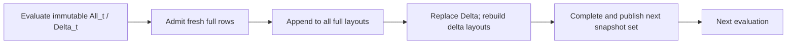

# Mac implementation: provider, maintained runs, then backend

Status: implementation decision and acceptance plan, **not a claim that a
production Metal provider or maintained Metal backend already exists**.

## Decision

Start with GPU-built, CPU-readable immutable indexes and an explicitly
host-owned append-only maintained-run provider. Preserve ordinary CQ and the
existing Datalog round semantics. Keep both **flat compaction** and **LSM-like
binary-carry runs** as selectable maintenance policies over the same run format.
Do not make a new logical join algorithm or a GPU-resident fixpoint scheduler a
prerequisite for those providers.

A data-structure swap is sufficient only for an immutable read-compatible
provider, or for externally maintained snapshots passed into an ordinary query.
It is not sufficient for asynchronous publication, multi-run retained ranges,
Datalog's generated layout updates, or a Metal-resident execution backend.

## Integrated state and compiler-change inventory

The GPU experiment is now at [experiments/mac/gpu-index](../experiments/mac/gpu-index/README.md),
alongside the main tree's optimized native `RadixRun`. Importing it did not
replace any runtime/compiler files from the older snapshot. The native cached
numeric-key sort, lazy exact dense-membership bitmap, H09 workload order, and
profiling changes remain intact. Historical experiment timings retain their
original source/machine provenance; integration is not a new performance result.

The current tree includes the following compiler/runtime boundary. The subsequent
provider-contract refactor replaces the earlier RadixRun name-specific checks:

| Layer | Existing change |
|---|---|
| `languages/cq-lang-structures/src/{lib,share,stage,join_filter,repr}.rs` | Check declared `supports [retain, expand, keys]` on the selected layout, with no provider-name admission or blacklist. |
| `passes/cq-sequence-pull/src/lib.rs` and Sequence catalogs | Target-owned registrations name implementations and their read/support contracts; selection and replay preserve live obligations. |
| `features/rewrites/passes/src/structures.rs` and lookup advice | Provider selection records support; generic retention/expansion/filter advice consumes it. Bare retyping clears stale promises; explicit retyping can replace them. |
| `runtime/cq-storage/src/{radix_run,radix_spline,sorted_run,sequence}.rs` | Native provider, grouping, membership cache and range adapter. This is runtime work. |
| `doc/formal/{ir_structures,backend}.tex`, `rules.tsv` | Existing provider/range obligations and rule inventory. |

The latest join tuning is provider/runtime optimization plus profiling plumbing;
it does not add CQ/VO/Physical operators. The recent upstream merge
`2698fc8f` separately brings H19 string interning, loader support, workload
changes and CUDA experiment advice/results; it does not add Mac execution or
an LSM lifecycle. The initial experiment import changed no compiler code; the
provider-contract refactor described here is a separate compiler change.

## Boundaries: how much compiler work?

| Target | Runtime work | Compiler work |
|---|---|---|
| GPU build, synchronous CPU reads of one immutable run | Metal buffer ownership, encoding, stable build, completion before exposure, lawful cursor | No new CQ/VO/Physical semantics. Declare actual provider support and register target reads; generic checks no longer need a new provider-name case. |
| External append-only LSM owner, ordinary CPU queries over frozen snapshots | Append/carry/manifest publication, all-run lookup, safe retirement | Can remain outside the core compiler. Expose snapshots through existing exact-read traits; do not claim a single contiguous Range capability. |
| Maintained Datalog indexes with CPU-controlled rounds | Batch admitted rows into full layouts; rebuild current delta layouts; publish complete snapshots | Feature-local Datalog storage/printer realization is needed. Reuse checked Round order rather than changing logical semantics. |
| Ordinary Metal-resident Sequence execution | Metal build/probe/expand/canon/output primitives and ownership/completion protocol | A real Metal machine/catalog/translator is needed; the active GPU translator emits CUDA. Existing finite-query Sequence vocabulary should be reused where it expresses the chosen execution. |
| Compiler-scheduled persistent GPU maintenance / asynchronous cross-query state | Explicit dependency, snapshot and retirement machinery | Requires an explicit checked lifecycle/scheduling design. Current Sequence has no append/compact/snapshot/round term; this is not provider substitution. Bring proposed core changes back for review before implementation. |

No new core language or logical planner change is required for the recommended
first two targets. Provider registration and capability-check changes still count
as compiler changes and should be reported separately, even when small.

Backend-private asynchronous command encoding does not by itself require new
core syntax: it may remain private while satisfying existing completion and
publication boundaries. Compiler-chosen build placement, transfers, cross-queue
overlap and persistent maintenance are different. `Catalog` provider levels
describe **consumption, not construction**; neither a provider token nor machine
grading establishes buffer readiness. Mac machine/layout and catalog adapters
can use the existing external `decompose`, `grade` and `print` pass slots.

### Implemented general provider boundary

An independently authored provider or alias can now record:

```text
index = MyProvider<_, _> [key] supports [expand, keys];
```

`retain` requires an exact immutable Copy lookup cursor. `expand` additionally
requires `ExactSizeIterator` and implies retain; it does not imply contiguous
Sequence Range or Ordered. `keys` uses the existing `Keys` trait. Native emission
proves declared support with Rust bounds, even without an optimization consumer.
It retains structural checks for coverage, selected payload versus candidate
layout, eager sharing, partiality, snapshot identity and witness escape.
Column markers likewise use a general `ColumnSlot<Host, N>` contract rather
than recognition of `ColumnAt` spellings. A marker alias selecting another slot
is rejected even when both columns have the same key type. Codec/layout checks
use the provider's Rust bounds rather than an AdaptiveKeySet name exception.

Selection/retyping and replay carry support with the provider. An unused default
host fallback does not impose Hash or other read bounds on a valid native host
path; actual dispatch proves the traits of the chosen handle. Unsupported
target shapes fail explicitly, including retained/expanded Smallest on native
realization and Structures staging/witness/filter decisions on the CUDA
Sequence target. This is not a new GPU or LSM implementation. The approved
provider-contract refactor has been merged back into `mini_linq-gpu-index-20261024`.

## Existing contracts to reuse

- [`Build` and `IndexRead`](../runtime/cq-storage/src/hash_index.rs) already state
  the immutable construction/exact-occurrence contract. `Build::build` is
  synchronous; `IndexRead` returns an iterator. Neither owns append, epochs,
  compaction, command completion, or publication.
  It also has no context argument or `Result` return. Prefer explicit fallible
  preparation with a caller-owned Mac context and pass the completed snapshot
  into ordinary queries. A compiled-build adapter needs an explicit context and
  failure policy; do not silently hide GPU setup failures or change `Build`
  globally to accommodate the first Mac provider.
  Recorded native host reads may additionally require `PointLookup`/`Rows`
  adapters and complete-row/key lifetimes; payload-only `IndexRead` is not enough
  to promise every host-access mode.
- [`RangeCursor`](../runtime/cq-storage/src/sequence.rs) requires one slice
  `items()` and one contiguous `range(key)` into that slice. A key occurring in
  several LSM runs does **not** satisfy that contract. Advertising Range merely
  because each individual run has a range would be incorrect.
- [`incremental.tex`](formal/incremental.tex), a **design specification**, already
  states lawful build/merge/read, generic runs, exclusive cuts, publication,
  set admission and maintained device-run laws. Use those obligations; do not
  invent Differential Dataflow timestamps, subtraction or retraction semantics.
- [`features/datalog/print`](../features/datalog/print/src/lib.rs) has
  `render_with_publication` for alternative checked publication realizations.
  Current initialization/layout emission and `full_insert`/`delta_rebuild`
  still use collection-style insertion; a new provider is not a type-only
  change to that generated code.
- [`GPU-DESIGN.md`](GPU-DESIGN.md) records removal of the former maintained-index
  backend. Historical provider-name exceptions have now also been removed from
  Structures; they grant neither capabilities nor a maintenance protocol.

## Runtime design

### One immutable run

A run owns its order-preserving encoded keys, occurrence/payload positions,
exact lookup directory, source-payload owner, and chronological batch interval.
Published buffers never mutate. GPU work writes new buffers and completes
successfully before any CPU-readable snapshot exposes them.

Reuse the measured four-pass 8-bit stable sort and parallel-partitioned merge.
A 32-bit position must remain tied to a stable source occurrence, not to a
movable temporary allocation. Sorting payload positions does not grant the GPU
permission to dereference arbitrary Rust references or copy arbitrary Rust
layouts. For borrowed/wide payloads, retain a typed host owner and resolve
positions on CPU, or explicitly build a lawful packed representation.

The experiment supports u32 keys/positions only. Native RadixRun also accepts
full-width signed/unsigned 64-bit and borrowed keys; those must not be narrowed.
An initial provider may explicitly advertise a smaller supported domain, but a
production replacement requires the intended full key domain, signed monotone
encodings, row-count limits, and payload-layout validation. Unsupported domains
must remain visibly unselected by advice, not be silently truncated.

Keep GPU exact radix-prefix and native CPU RadixSpline directories distinct.
The former avoids sequential spline construction but has unmeasured probe costs
and skewed buckets on dense key domains. Choose using matched build-plus-read
workloads, including the native membership-only optimization, not build time alone.

### Maintained owner and immutable snapshots

These are proposed responsibilities, not a fixed public Rust API:

- **Writer:** owns publication state, pending batches and the chosen compaction
  policy. A batch is admitted and assigned its chronological interval once.
- **Pending update:** owns unpublished runs, directories and command-use lifetimes.
- **Snapshot:** owns one immutable manifest containing an epoch and all visible
  runs/payload owners. A query pins one snapshot; subsequent reads cannot follow
  a mutable latest-version pointer.
- **Cursor:** borrows the query's pinned snapshot, or owns the necessary snapshot
  references. Prefer borrowing a once-pinned snapshot over per-row/per-probe
  reference counting. Buffer reuse waits for both snapshot/cursor lifetimes and
  in-flight GPU readers.

Prepare the delta, sort it, perform selected carries and build directories in
unpublished storage. Publish the complete new manifest only after successful
GPU completion. Failed completion leaves the previous manifest visible; no
mixed run/directory pair may become readable. Multiple indexes of a relation,
and every relation required by one Datalog evaluation, must publish a
version-consistent set before that evaluation starts.

Retained snapshots may keep old allocations alive while a newer manifest
compacts across their historical boundaries. This is persistent snapshot
retention, not a promise to reconstruct arbitrary cuts inside an already merged
interval. Reclamation is part of the implementation cost and acceptance gate.

### Maintenance policies

1. **Flat:** stable sort of the accepted delta, merge with the existing run,
   rebuild the directory, publish one run. It minimizes read amplification but
   rewrites the accumulated base on each publication.
2. **Binary carries / LSM-like:** publish immutable sorted batches; when a level
   is occupied, merge chronologically adjacent older/newer runs into the next
   level. Keep at most one run per level. Initially levels represent batch-count
   rank, not an asserted row count: variable-sized batches do not have equal
   physical sizes. Size-tiered thresholds are a separate measured policy.

Both policies preserve the same abstract occurrence bag. LSM-like here means
in-memory append-only sorted runs and compaction, not disk persistence, WAL,
last-write-wins keys, tombstones or deletes.

Lookup must examine **every occupied run** and concatenate exact key matches in
source chronology, not numerical level order. Equal keys and identical payload
occurrences remain present. Merge takes the older run first on equal keys;
payload values are never tie-breakers. Membership is OR across exact per-run
membership, while counting sums matching occurrences.

Start with Exact/Membership and ordinary iterator cursors. Do not flatten all
runs on every query to manufacture Range support. A snapshot-bound multi-run
cursor may declare `retain`/`expand` if it truly satisfies the immutable
Copy/exact-size contracts; implement efficient positioning rather than repeated
full scans. This still does not satisfy the distinct contiguous-array
`RangeCursor` contract. Device expansion of multiple segments remains target
runtime work, not a reason to add an LSM type-name exception to core checks.

## Datalog integration: preserve the existing round

Current production ordering is:



Use existing full-row `seen` admission first: candidates are self-deduplicated
and checked against accumulated facts before maintained layouts receive them.
The index itself still preserves occurrences. Equal projected keys with different
payloads are not duplicate facts. Ordinary CQ bag indexes must never inherit
Datalog's set admission accidentally.

All readable full layouts already include the currently published delta. Keep
that invariant. A different frontier scheme that probes a delta against an older
full index and only then absorbs that same delta can omit delta–delta joins in
nonlinear recursion. Such a scheme needs a checked coverage argument and is not
a representation-only optimization.

The feature-local integration should batch admitted rows once per publication,
complete all requested full-layout updates, replace/rebuild delta layouts even
when empty, and only then enable the next evaluation. Initialization and EDB
canonicalization must use the same lawful provider path. Existing row-by-row
`.entry(...).or_default().push(...)` emission cannot express the required GPU
batch finalization without a publication realization change.

## Implementation order and gates

1. **Lawful immutable Mac provider.** Isolate Metal in a Mac-specific runtime
   outside the default portable dependency path. Implement complete build and
   CPU lookup for the explicitly selected key/payload domain; pin ownership and
   complete GPU work before returning. Check exact outputs against native hash
   and RadixRun. Measure allocation, encoding, synchronization, payload gather,
   build, membership and expansion separately, then end-to-end.
2. **Online flat and binary-carry owner.** Query every intermediate manifest,
   especially 3/5/6/7 batches, empty/unequal batches and cross-run duplicate keys.
   Hold partially consumed cursors across append/compaction and writer disposal;
   the old snapshot must remain exact while the new one sees appended rows.
   Validate completion/error publication and retirement. The offline eight-batch
   experiment does not satisfy this gate.
3. **Feature-local Datalog realization.** Preserve current Round checks and set
   admission. Test seeds, mutually recursive relations, nonlinear delta–delta
   cases, overlapping semi-naive variants, duplicate EDB/candidate facts, empty
   delta replacement and frozen lower-stratum negation against the existing
   evaluator. Ensure each full/delta layout is maintained once per publication,
   with no hidden per-hole full rebuild.
4. **Read-policy and cost selection.** Compare flat versus binary carries using
   build-plus-probe workloads and memory high-water marks. Include all-level
   probe cost, compaction amplification, pending/retained generations, batching
   latency and CPU/GPU shared-memory contention. Do not import M5 coefficients
   into this M3 experiment. Keep small-update CPU versus GPU placement explicit;
   no crossover threshold has yet been established by end-to-end query tests.
5. **Metal-resident query backend, then lifecycle scheduling if justified.**
   Implement and grade actual Metal primitives; reuse existing finite-query
   Sequence obligations. A future persistent/async maintenance schedule must
   explicitly represent its dependencies and lifetimes and obtain separate
   core-design review. Do not resuscitate the removed GPU Datalog bridge.

## Integration verification

After importing the experiment into the current join-optimized tree:

- `cargo test -p cq-storage -p cq-lang-structures -p cq-sequence-pull --all-features`:
  149 tests passed.
- `cargo run --manifest-path features/rewrites/Cargo.toml --example radix_runs`:
  hash, immediate RadixRun, retained, staged32 and retained+staged32 each produced
  150 identical exact answers.
- `cargo run --release --locked --manifest-path experiments/mac/gpu-index/Cargo.toml -- --check-only`:
  actual Metal stable sort/merge, grouping, directory and exact-range checks passed.
- The integrated `--updates-only --sizes 65539 --runs 1` smoke also exercised
  irregular-size updates and both offline maintenance histories, with batched
  and separately completed submissions. Output:
  `experiments/mac/gpu-index/target/integration-smoke.json`. This validates the
  imported experiment, not the proposed online snapshot/LSM owner.

### Provider-contract refactor verification

- Standard workspace gate: 958 tests passed.
- Rewrite workspace: 187 tests passed, including custom/aliased providers,
  retained native/fallback host cursors, unit-key occurrence order, and
  compilation rejection of false cursor/key/codec/marker contracts.
- Sequence rewrite/replay workspace: 99 tests passed.
- External push target: 237 tests passed; join-filter workspace: 7 tests passed.
- The five-route native join executable still returns 150 exact answers per route.
- All 27 public API snapshots were updated and checked; the formal inventory
  check passes for 245 rules.

Broader gate limits are recorded rather than hidden: `--all-features` enables
the untouched optional HW4 aggregate exercises, whose two unimplemented cases
fail while the other workspace targets pass. The dependency checker reports
version drift in the Datalog, own-dialect and Sequence-rewrite lockfiles;
those files and the root lockfile match the untouched snapshot byte-for-byte.
The full CUDA workspace still requires missing machine-local
`/data/cuda-oxide` patches. Its actual compiler sources passed 15 host-only
unit checks through a temporary isolated manifest; CUDA device execution was
not exercised. No such prerequisite was bypassed by changing runtime behavior.

No production Mac provider, online LSM owner or Datalog publication change was
implemented here. The general provider-contract refactor is present in both the
main tree and the GPU experiment folder following the approved merge-back.
