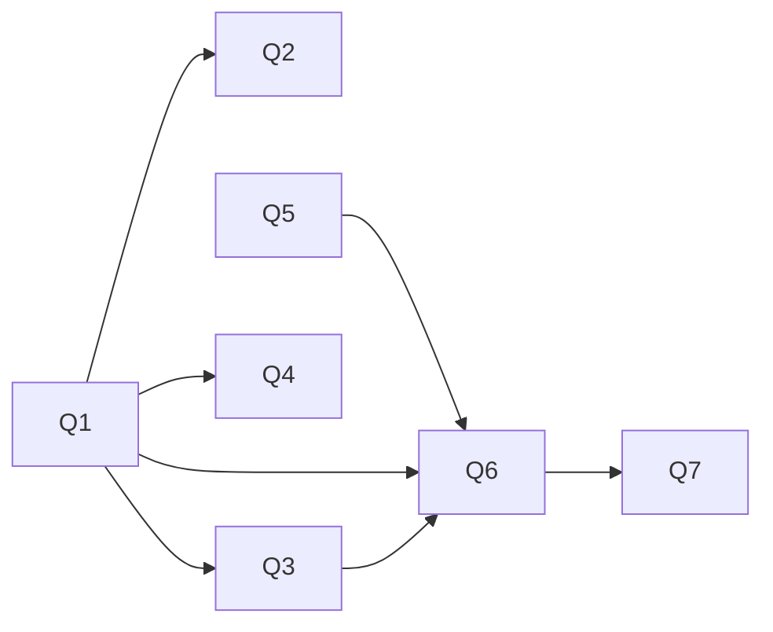

# Next step: staged quotation for plan control

Starts after the current runtime work (join filters, bushy branches, batched
probes) is integrated, benchmarked and committed.

## Goal

A query can control any lower IR level without changing the compiler stages it
passes through, without a fixed nesting depth, and without any layer listing
the layers below it. Every applied quote is checked by its level's checker, so
quotes change cost, never answers:
$[\![\mathrm{Rust}]\!] = [\![\mathrm{CQ}]\!]$ for every envelope.

## Feature categories

| Category | Current features | Destination |
|---|---|---|
| Meaning | CQ core, blocks, surface sugar, negation/aggregate/correlated/recursion extensions, `relation_loaders` | language; never quotes |
| Assumptions | `#[total] if`, `select(positional(H))`, user types in `retype` | one `assume { … }` block / environment |
| Choices with arguments | `cq_planners::order(...)`, `plan(no_reduce)`, `merge_joins`/`smallest` (`arguments { r2 }`), `retype`/`custom_indexes`/`ordered_dedup`, bushy branches, build side, join-filter kind, batch size | quotes and directives |
| Choices without arguments | default `plan`, `smallest_intersections`, `canon_prefixes`, `lazy_semijoins`, selection heuristics | pipeline stages; quotes override their results |
| Pipeline shape | `pipeline { … }`, planner choice, `push` vs `print_pull`, stacked-IR bridge, diverged-RA passes | pipeline configuration |
| Tooling | `capture_*`, `corpus_*`, inspection, composition | unchanged; used as acceptance harnesses |

The parameterized rewrites are already quotes in disguise, but they are keyed by
generated result names (`r2`). Stable provenance names are therefore the main
prerequisite.

## Syntax

```text
quote <lang-tag> [after <pass-path>] @ <occurrence> { <tokens> }
```

- `<lang-tag>`: an open name owned by the target language.
- `after`: selects a later producer when one language appears several times.
- `@ <occurrence>`: a source-provenance anchor that `cq-stage` reads without
  parsing the body.
- Body: a raw token tree, parsed only by the target language; it may nest quotes.

## Steps

1. **Q1 Envelope** (`facade/cq-stage`). Add an optional `quotes { … };` slot
   to `Input`/`Pipeline::start`. `run` hides the envelope from passes, splices
   the quotes whose tag and position match `Out`, re-enqueues nested quotes,
   runs `check` and `check_rewrite`, forwards everything else byte-identical,
   and rejects unconsumed quotes at the terminal stage. Add
   `Language::tag()` and `Language::splice()`; the default `splice` rejects.
2. **Q2 One input format.** `cq-ext-support::SurfaceInput` reuses
   `cq_stage::Input`.
3. **Q3 Fork routing.** Add `Pipeline::start_fork(hole, covered_occurrences)`.
   The aggregate, negation, correlated and recursion extensions declare which
   occurrences each hole covers. Each anchor must lie in exactly one hole;
   quotes are routed only there.
4. **Q4 Layer opacity.** Remove the aggregate extension's printer-path test
   (`expansion.rs:242`); expose the needed fact through the language or
   Structures. Turn `Configuration`'s named phases into sugar over `Pipeline`.
5. **Q5 Provenance.** Record checked source-occurrence provenance in RA and
   Physical definitions, preserved through printing. Splices resolve names by
   provenance, not by `symbol_name` strings or generated names.
6. **Q6 Migrations.**
   1. Structures `splice`; migrate `retype`, `custom_indexes`, `ordered_dedup`.
   2. Physical `splice`; migrate `merge_joins`, `smallest`.
   3. Move `positional(H)` and `#[total]` facts into `assume { … }`.
   4. VO `splice` for order, branches and reductions; RA `splice` for build side.
7. **Q7 Directives.** A surface pass expands stable directives (`order`,
   `branch`, `reduce`, `build`, `type`, `join_filter`) into quotes. Raw
   `quote` remains the developer escape hatch.



## Acceptance

| Invariant | Evidence |
|---|---|
| No quotes means no change | every IR and the generated Rust byte-identical across the full corpus |
| Passthrough | envelope tokens identical before and after each non-target stage |
| Locality | pass functions have no envelope parameter |
| Soundness | a splice that `check_rewrite` rejects fails compilation |
| Openness | protocol code compares tags only through `Out::tag()` |
| Fork completeness | an anchor in no hole or in two holes fails at the fork; an unconsumed quote fails at its branch terminal |
| End to end | a nested quote passes untouched through CQ, VO, RA, IX and Physical, then splices at Structures, through a fork |
| Migration | the existing `retype` and `merge_joins` tests pass using quotes instead of `arguments { r2 }` |

## Risks

- Q5 changes every IR below VO and needs the most review.
- A forking extension that bypasses `start_fork` must not drop quotes: plain
  `start` with a non-empty envelope is an error.
- The envelope is re-emitted at every stage; measure its cost once directives
  expand into many quotes.
